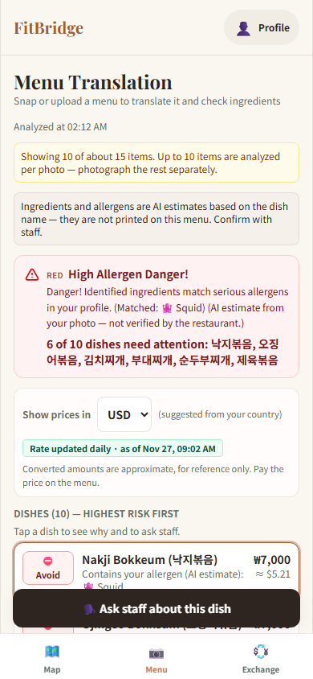

# 전포 AI (FitBridge) V2

외국인 여행자가 한국 식당의 **메뉴판이나 음식 사진**을 찍으면 메뉴를 번역하고, 자신의 **알레르기·식이·맵기 프로필**과 비교해 위험 요소를 먼저 보여 주는 웹 앱입니다.

- AI 분석: Google Gemini (서버리스 함수에서만 호출, API Key는 브라우저에 노출되지 않음)
- 프론트엔드: React 19 + TypeScript + Vite (`web/`) — 기존 Vanilla JS 버전(`index.html`)은 비교 기준으로 보존
- 6개 언어: English, 日本語, 简体中文, Tiếng Việt, Español, 한국어

> 앱의 결과는 **AI 추정**입니다. GREEN은 "프로필과 일치하는 성분을 찾지 못함"이라는 뜻이며, 안전 보장이 아닙니다. 심한 알레르기가 있다면 반드시 직원에게 확인하세요.



> **최종 검증(2026-11-28):** 실제 식당 메뉴판(15개 항목)으로 앱 전체 흐름을 확인했다. 음식명·가격 10/10 일치, 분석 범위 안내, 자동 환산과 통화 동기화, 음식별 위험도, 직원 질문·TTS, 새로고침 복원 — Gemini 호출 1회. 결과와 남은 한계는 [docs/TEST-REPORT.md §10](docs/TEST-REPORT.md)에 있다.

## 주요 기능

- **메뉴판·음식 사진 분석:** 사진 1장당 최대 10개 항목. 일부만 분석되면 "약 N개 중 M개"로 안내합니다.
- **음식별 위험도:** 메뉴판의 각 음식에 위험 배지(피하기 / 확인 필요 / 불확실 / 일치 없음)와 이유를 표시합니다. 아이콘과 글자로 구분하며 색상만으로 구분하지 않습니다. 위험한 음식이 먼저 나오고, 프로필을 바꾸면 재분석 없이 즉시 반영됩니다.
- **음식 선택 중심 흐름:** 음식을 고르면 위험 이유, 식재료, 지식 DB 확인, 직원 질문(TTS/복사), 내 식사 기록이 모두 그 음식 기준으로 바뀝니다. 지도에서 고른 식당은 메뉴판 분석과 기록까지 이어집니다.
- **정보 출처 표시:** AI 추정, 사진 글자에서 읽음, 문헌 기반 식품 지식 DB, 데모 데이터를 각각 따로 표시합니다.
- **메뉴판 가격 · 환산:** 메뉴판에 인쇄된 가격만 읽어 음식 옆에 원화로 보여 주고, 선택한 통화로 환산한 참고 금액(≈)을 함께 표시합니다. 가격을 추정하지 않으며, 환율 탭과 같은 통화 설정과 환율 데이터를 씁니다.
- **직원 질문 4유형**(재료 / 내 알레르기 / 교차 오염 / 종합): 선택한 음식 기준이며, 주의 음식 전체를 한 번에 물을 수도 있습니다. 한국어 문구, 음성(TTS), 복사를 지원합니다.
- **기타:** 리뷰 저장·수정·삭제(기기 내 저장), 지도, 환율 계산기.

## 로컬 실행

필요: Node.js 20 이상(개발 환경 v24), Gemini API Key (https://aistudio.google.com/apikey)

```bash
# 1. 프로젝트 루트에 .env 작성 (Git에 커밋되지 않음)
echo "GEMINI_API_KEY=발급받은_키" > .env

# 2. 백엔드 (api/ + data/generated) — :3000
node dev-server.js

# 3. React 개발 서버 — :5173 (/api, /data는 :3000으로 프록시)
cd web && npm install && npm run dev
```

WSL 네트워크 경로(`\\wsl.localhost\...`)에서 Windows로 실행하면 Vite 파일 감시가 동작하지 않습니다. `web/node_modules`를 WSL에서 설치했다면 TypeScript 7·Vite 8의 네이티브 바이너리가 Linux용이므로, 빌드와 서버는 WSL 셸에서 실행하세요(Playwright는 `node node_modules/@playwright/test/cli.js test`로 어느 쪽에서도 실행할 수 있습니다).

## 테스트

```bash
cd web && npx tsc -b && npm run build                      # 타입 검사 + 프로덕션 빌드
cd web && npx vite preview --port 4173                     # 프로덕션 번들 (백엔드 :3000 필요)
cd web && E2E_BASE_URL=http://localhost:4173 npx playwright test   # Mock API E2E (mobile + desktop)
node tests/pkg5-after.js                                   # 서버/오류 처리 (Mock) — 그 밖의 tests/*.js도 같은 방식
py -m unittest tests.test_food_knowledge                   # 식품 지식 ETL
py scripts/validate_food_knowledge.py                      # Master DB 검증
```

실제 메뉴판 사진 1장 확인: `node scripts/verify-real-menu.cjs <사진.jpg> --currency USD`(실행 중인 백엔드로 분석 1회).

실제 Gemini를 호출하는 E2E는 기본적으로 건너뜁니다. 실행하려면 `REAL_GEMINI=1`을 지정하세요(호출 비용 발생). 결과는 [docs/TEST-REPORT.md](docs/TEST-REPORT.md)에 있습니다.

## 배포

`vercel.json`이 준비되어 있습니다(React 빌드 + 루트 `api/` 서버리스 함수). Vercel 환경변수에 `GEMINI_API_KEY`를 등록하세요(`VITE_` 접두어 금지). **공개 배포 전에는 요청 제한과 비용 상한 설정이 필요합니다.** 자세한 내용은 [docs/DEPLOYMENT.md](docs/DEPLOYMENT.md)에 있습니다.

## 문제 해결

| 화면 안내 | 원인 / 조치 |
|---|---|
| "분석 서비스 설정에 문제" | `GEMINI_API_KEY` 누락 또는 무효, 모델 접근 불가. 서버 로그의 `[analyze-menu] AI_CONFIG` 줄에서 상태와 사유를 확인 |
| "요청이 많아 잠시 처리할 수 없음" | Gemini 쿼터 초과(429). 잠시 후 다시 시도 |
| "오늘 무료 AI 분석 한도에 도달" | 무료 등급 일일 요청 한도 초과. 표시된 시간 이후 다시 분석(그 전에는 서버가 Gemini를 호출하지 않음). 지도·환율·프로필·리뷰는 계속 사용 가능 |
| "짧은 시간에 분석 요청이 많았습니다" / "AI 처리량" | 분당 요청·토큰 한도. 버튼에 표시된 시간 이후 다시 시도 |
| "한 번에 분석하기에는 항목이 너무 많음" | 응답이 출력 한도에서 잘림. 메뉴판 일부만 찍어 다시 시도 |
| "음식이나 메뉴 항목을 찾지 못함" | 음식과 무관한 사진이거나 글자를 읽을 수 없는 사진 |
| 화면 하단 "기술 정보" | 개발자용 오류 코드(`AI_QUOTA · HTTP 429` 등). 서버 로그와 함께 확인 |

Gemini 무료 등급에서는 Google이 사진과 응답을 모델 개선에 사용할 수 있습니다. 결제를 활성화하면 이를 해제할 수 있습니다(Google 약관 참고).

## 문서

| 문서 | 내용 |
|---|---|
| [docs/ARCHITECTURE.md](docs/ARCHITECTURE.md) | 구조, 요청 흐름, 오류 모델, 정보 출처 구분 |
| [docs/V2-CHANGELOG.md](docs/V2-CHANGELOG.md) | 해커톤 원본 / Vanilla V2 / React V2 비교 |
| [docs/TEST-REPORT.md](docs/TEST-REPORT.md) | 최종 테스트 결과 (Mock / 실제 API 구분) |
| [docs/DEPLOYMENT.md](docs/DEPLOYMENT.md) | Vercel 배포 설정과 공개 배포 전 필수 항목 |
| [docs/PORTFOLIO.md](docs/PORTFOLIO.md) | 문제 해결 사례와 정량 성과 |
| [docs/UX-AUDIT.md](docs/UX-AUDIT.md) | 실제 브라우저 기반 UX 감사(개선 전) |
| [docs/UX-IMPROVEMENT.md](docs/UX-IMPROVEMENT.md) | UX 통합 개선과 같은 조건의 전후 측정 |
| [docs/devlog/](docs/devlog/) | 과제별 개발 기록 (IMP-01 ~ PACKAGE-05) |
| [PRD.md](PRD.md), [CLAUDE.md](CLAUDE.md) | 해커톤 팀 요구사항과 합의 |
