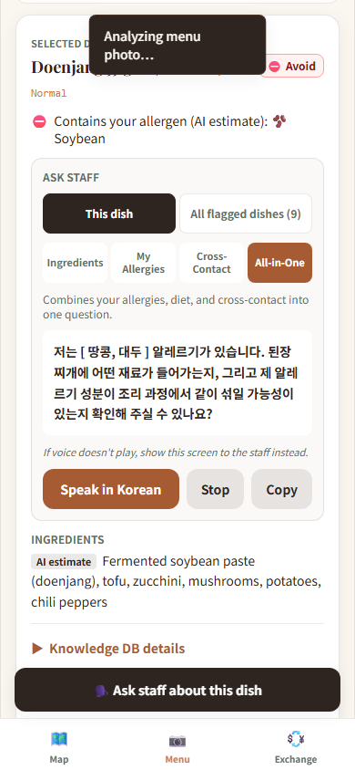

# 포트폴리오 — 전포 AI (FitBridge)

외국인 여행자가 한국 식당 메뉴판을 찍으면 메뉴를 번역하고, 자신의 알레르기·식이·맵기 프로필과 비교해 위험 요소를 먼저 보여 주는 웹 앱이다.

## 1. 성과 구분

| 단계 | 형태 | 내 역할 / 결과 |
|---|---|---|
| A. 해커톤 원본 (`a91f46c`) | 3인 팀 | 기능별 분담(입맛 프로필 / AI 메뉴 분석 / 직원용 알레르기 카드). 단일 HTML + Gemini 서버리스 함수. 테스트 없음 |
| B. Vanilla V2 (`b3a5751`) | 개인 개선 | 신뢰성·안전성 중심 재설계(IMP-01 ~ IMP-18D-2), JS 테스트 케이스 241개 + Python 31개 |
| C. React V2 (Package 4~5 + UX 통합 개선) | 개인 개선 | TypeScript 재작성, 실제 API 장애 해결, 배포 준비, 실사용 UX 감사 → 통합 개선. JS 261개 + Playwright 31개 시나리오 × 2 기기 |

해커톤의 수상 여부나 평가 결과는 이 저장소에 기록이 없어 적지 않았다.

## 2. 대표 기술 문제와 해결

### 2.1 실제 메뉴판만 실패하는 502 (Package 5)
- **현상:** 단일 음식 사진은 성공했지만, 9개 품목 한식 메뉴판에서는 "analyze-menu failed: 502"가 표시됐다.
- **조사:** Key 형식을 원인으로 단정하지 않고, 실제 응답의 `finishReason`과 `usageMetadata`를 기록했다. 결과는 HTTP 200, `MAX_TOKENS`였고, 사고 토큰 2,044 + 답변 1,013이 한도 3,072에 도달해 있었다.
- **원인:** Gemini 2.5 Flash의 사고 토큰이 출력 한도를 함께 소비해, 답변 JSON이 3개 품목쯤에서 잘렸다.
- **해결:**
  - 분석은 사고 1,024 + 한도 8,192, 번역은 사고 0으로 설정했다.
  - `finishReason`별 오류 코드를 도입했다.
  - 수정 후 같은 메뉴판에서 10개 항목 분석에 성공했다(14.5초). 번역도 10/10 성공했다.
- **재발 방지:** 기준 커밋 핸들러에 실측과 같은 Mock을 넣어 502를 재현하는 테스트(`tests/pkg5-repro-before.js`)와 수정 후 테스트 19개를 추가했다.

### 2.2 "안전해 보이는" 잘못된 표시 막기 (B~C)
- 결측·무효 데이터를 GREEN으로 처리하지 않고 UNKNOWN/ERROR로 분리했다(IMP-01/03).
- GREEN을 "일치 없음, 보장 아님"으로 표현했다.
- 이름만 적힌 메뉴는 재료가 "AI 추정"임을 표시했다.
- 일부 항목만 분석되면 "약 N개 중 M개"로 안내했다.
- 새 분석이 실패했을 때 이전 사진의 결과가 남아 있던 버그를 수정했다.

### 2.3 근거 기반 알레르기 데이터 (B)
- Excel 마스터 DB → Python ETL(추출·검증·변환) → JSON으로 이어지는 파이프라인을 만들었다.
- AI 판정은 바꾸지 않고, 문헌 근거가 있는 재료–알레르겐 관계만 "추가 확인 정보"로 덧붙였다.
- 화면에 근거 출처와 "전문가 검토 전" 상태를 함께 표시했다.

### 2.4 감사 → 개선: 기능을 하나의 사용자 여정으로 (C)
- **방법:** 소스 분석이 아니라 실제 브라우저에서 관광객 여정(온보딩 → 지도 → 메뉴판 → 위험 확인 → 직원 질문 → 리뷰)을 클릭, 측정하고 문제를 코드 위치와 함께 기록했다(docs/UX-AUDIT.md).
- **핵심 발견:** 음식 10개를 분석해도 어떤 음식이 위험한지 알 수 없었다(배너 1개). 직원 질문은 9개 음식을 한 문장에 넣었고, 지도의 "Scan Menu Here"는 데모를 보여 줬다. 새로고침하면 결과가 사라졌다.
- **개선:** 기존 판정 로직은 그대로 두고 화면 구조를 바꿨다.
  - 음식별 위험 배지와 선택 음식 하나를 중심으로 위험 이유 → 직원 질문 → 재료 → 근거 → 리뷰가 이어지게 했다.
  - 분석 결과·선택 음식·식당을 세션에 복원하고 탭을 URL 해시에 반영했다.
  - 6개 언어 미번역을 0건으로 만들었다.
- **측정(같은 조건 재측정):** 분석까지 지도 경유 10 → 8 클릭(직접 경로 9 → 5), 직원 질문까지 3,013px 스크롤 → 1탭, 음식별 위험도 0/10 → 10/10 표시, 연계 실패 6 → 1, 44px 미만 터치 유형 5 → 0, 결과 화면 높이 3,481 → 2,393px(docs/UX-IMPROVEMENT.md).

### 2.5 메뉴판 가격 × 환율 (C)
- 기존 이미지 분석 요청에 "인쇄된 가격만" 추출하는 필드를 추가했다(추정 금지, 범위·불명확·미표시 구분, 0원 표시 금지).
- 탭마다 따로 조회하던 환율을 하나의 공통 상태로 합쳤다(요청 공유, 출처 갱신 시각까지 캐시). 메뉴 결과와 환율 탭이 같은 선호 통화를 쓴다.
- 이 과정에서 기존 환율 탭의 JPY 10배 오차(100 JPY ≈ 84 KRW로 표시)를 발견해 수정했다.
- 결과: 음식 3개 가격을 내 통화로 확인하는 데 7 클릭 + 3 입력 → 0. 통화나 음식을 바꿔도 분석·번역·환율 추가 호출 0회. 실제 메뉴판 가격 10/10 일치, 가격이 잘린 사진에서는 추정 0건.

### 2.6 비용과 응답성 (B~C)- 이미지 분석과 번역을 분리하고 캐시했다. 언어를 바꿔도 이미지를 다시 분석하지 않는다.
- 같은 사진은 서버 캐시를 사용하고, 일시 오류만 백오프로 재시도한다. 오래된 응답은 취소한다.
- 코드 분할로 첫 화면 JS를 563 KB에서 352 KB로 줄였다(gzip 180 → 115 KB, 실측).

## 3. 정량 지표 (실측만)

| 지표 | 값 |
|---|---|
| 실제 9품목 메뉴판 분석 | 수정 전 실패(MAX_TOKENS → 502) → 수정 후 10개 항목, 14.5초 |
| 10개 요리 일본어 번역 | 10/10, 8.7초 |
| 초기 로딩 JS | 563.34 KB → 351.80 KB (gzip 179.79 → 115.34 KB) |
| 자동 테스트 | JS 276개 케이스, Python 31개, Playwright 86개 통과(43 시나리오 × 2 기기, 실제 API 1 시나리오는 별도 옵트인) |
| 메뉴판 가격(실제 Gemini) | 인쇄된 가격 10/10 일치 · 가격 열이 잘린 사진 7/7 "표시 없음"(추정 0) || UX(같은 조건 재측정) | 첫 진입 → 메뉴 분석 10 → 8 클릭(지도 경유) / 9 → 5(직접) · 직원 질문 도달 1탭 · 음식별 위험도 10/10 · 새로고침 복원 ✓ · 6개 언어 UI 미번역 0 · 콘솔 오류 0 |
| 실제 식당 메뉴판 최종 검증 | 한마음식당 15개 메뉴: 음식명·가격 10/10 일치, "약 15개 중 10개" 범위 안내, `₩7,000 ≈ $5.21` 자동 환산, 오징어 알레르기 → 오징어볶음·낙지볶음 Avoid, 새로고침 복원. 전체 흐름 Gemini 1회 |
| 첫 로드 JS(UX 개선 후) | 372.66 KB(Package 5 대비 +5.6%, 온보딩 알레르기 단계 포함) |
| 보안 점검 | Git 전체 기록과 빌드 결과물의 Key 노출 0건, `npm audit` 0건 |

## 4. 기술 스택

React 19, TypeScript, Vite 8, Zustand 5, Tailwind CSS v4, Leaflet, Playwright / Vercel Serverless (Node), Google Gemini 2.5 Flash / Python (ETL, unittest)

## 5. 남은 과제 (정직하게)

- 공개 배포 전에 요청 제한, 비용 상한, 개인정보 고지가 필요하다(docs/DEPLOYMENT.md §5).
- 실제 단일 음식 사진과 성분표 사진은 실제 API로 검증하지 않았다.
- 스크린 리더 실사용 검사, 실제 TTS 음성 품질, iOS/Android 실기기 검증을 하지 않았다.
- 실제 메뉴판 검증은 디지털로 제작된 메뉴판 1장으로 했다. 휴대폰으로 찍은 사진(기울기·반사)은 미검증이다.
- 사진 1장당 10개 상한(15개 메뉴 중 5개는 따로 촬영 필요, 화면에서 안내). 낙지가 오징어 알레르겐으로 분류된다(문어 항목 없음, 보수적 방향).
