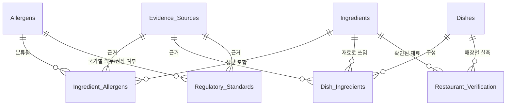

# IMP-18 — 식품 지식 Master DB 설계 및 서비스 연동 계획

> 상태: **설계안, 코드 변경 없음.** IMP-11(완료)의 `shared/allergens.js`를
> 깨지 않고 확장하는 것을 최우선 제약으로 삼았다. 실제 데이터 구축과
> 코드 수정은 사용자 승인 후 별도 단계에서 진행한다.
> 근거 자료: [IMP-17 조사 문서](../research/IMP-17-allergen-standards.md)

---

## 1. 현재 `shared/allergens.js` 21종 전체 목록 및 구조 (사실 확인)

```js
// 현재 구조 (IMP-11에서 구축)
{ id, legacyIds: [], labels: { ko, en, ja, zh, vi, es }, icon }
```

| # | id | ko | 근거(IMP-17 조사 결과) |
|---|---|---|---|
| 1 | peanut | 땅콩 | 한국 MFDS 19종 |
| 2 | walnut | 호두 | 한국 MFDS 19종 |
| 3 | pinenut | 잣 | 한국 MFDS 19종 (legacyIds: ['pineneut']) |
| 4 | wheat | 밀 | 한국 MFDS 19종 |
| 5 | buckwheat | 메밀 | 한국 MFDS 19종 |
| 6 | egg | 계란 | 한국 MFDS 19종 |
| 7 | milk | 우유 | 한국 MFDS 19종 |
| 8 | shrimp | 새우 | 한국 MFDS 19종 |
| 9 | crab | 게 | 한국 MFDS 19종 |
| 10 | squid | 오징어 | 한국 MFDS 19종 |
| 11 | mackerel | 고등어 | 한국 MFDS 19종 |
| 12 | shellfish | 조개류 | 한국 MFDS 19종(굴/전복/홍합) |
| 13 | fish | 생선 | **한국 MFDS에는 없음** — 미국/EU/영국/Codex 국제 표준 + locations 데모의 실제 교차오염 사례 근거 |
| 14 | soybean | 대두 | 한국 MFDS 19종 |
| 15 | pork | 돼지고기 | 한국 MFDS 19종 |
| 16 | beef | 소고기 | 한국 MFDS 19종 |
| 17 | chicken | 닭고기 | 한국 MFDS 19종 |
| 18 | sesame | 참깨 | **한국 MFDS에는 없음** — 미국(2023)/EU/영국/Codex(2024) 국제 표준, 일본은 권장(의무 아님) |
| 19 | peach | 복숭아 | 한국 MFDS 19종 |
| 20 | tomato | 토마토 | 한국 MFDS 19종 |
| 21 | sulfites | 아황산류 | 한국 MFDS 19종 |

**총 21종 = 한국 MFDS 법정 19종(100% 포함) + 국제 표준 기반 2종 추가(fish, sesame).**
이 사실관계는 IMP-17 조사에서 처음으로 명시적으로 확인되었다(원본 해커톤
코드의 주석에는 "19 Standard Food Allergens"라고만 적혀 있었고 어떤 법령
근거인지 명시되어 있지 않았다).

---

## 2. 기존 데이터와 국제 알레르기 표시 기준 비교 → 분류 관계

IMP-17의 비교표를 분류 관계로 재구성하면:

| 분류 | 포함 id | 비고 |
|---|---|---|
| **한국 법정 + 국제 표준 공통** | milk, egg, wheat, peanut, soybean, shrimp, crab, walnut | 거의 모든 기준에서 겹침 — "핵심 중의 핵심" |
| **한국 법정에만 있음(국제 표준엔 없거나 약함)** | buckwheat, mackerel, shellfish(연체동물 세분화), pork, beef, chicken, peach, tomato, sulfites, pinenut(EU는 미명시) | 한국 역학/식문화 반영 — 외국인 여행자에게도 "한국 음식 맥락"에서 여전히 중요하므로 유지 |
| **국제 표준에만 있고 한국 법정엔 없음(IMP-11에서 추가)** | fish, sesame | 국제적으로는 핵심이지만 한국 법은 요구하지 않음 — 외국인 여행자 서비스이므로 유지가 타당 |
| **추가 후보(지금 미등록, 향후 검토)** | celery(셀러리), mustard(겨자), lupin(루핀) | EU/UK에만 있고 한국 음식에서의 실제 노출 빈도는 미확인 — **지금 추가하지 않는다.** 근거(실제 한국 식당 메뉴에서의 노출 사례)가 확인되기 전까지는 `Evidence_Sources`에 "후보"로만 기록 |
| **세분화 후보(지금 뭉뚱그려짐)** | tree nut 세분화(아몬드/캐슈/피칸/헤이즐넛/마카다미아), 생선 세분화(연어/고등어 외) | 지금 "walnut"/"pinenut"/"mackerel"만 개별 등록, 나머지는 없음 — 실제 메뉴 데이터 확보 후 판단 |

**원칙 재확인(사용자 지시 그대로 적용)**: 위 "추가 후보"는 **지금 단계에서
표준 목록에 넣지 않는다.** 서로 다른 분류(어류/갑각류/연체동물)를 하나로
합치지 않으며, 의미가 불확실한 것은 임의로 매핑하지 않는다 — IMP-11에서
이미 지킨 원칙을 그대로 연장한다.

---

## 3. 활용 가능한 공공데이터 API 및 이용 조건

IMP-17 3절 요약:

| API | 쓰임새 | 알레르기 자동판정에 쓸 수 있는가 |
|---|---|---|
| 조리식품의 레시피 DB(`COOKRCP01`) | `Dishes`/`Dish_Ingredients`의 "일반 레시피" 시드 데이터(재료 텍스트) | **아니오** — 알레르기 필드 자체가 없음. 재료 텍스트를 우리 `Ingredient_Allergens`로 다시 매핑해야 함 |
| 식품 원재료 정보(`FoodRwmatrInfoService01`) | `Ingredients` 테이블의 원재료명/코드 표준화 | 직접 확인 안 됨(검증 필요) — 필드 상세는 실제 연동 단계에서 재조사 필요 |
| FoodOn | 장기적 국제 상호운용성(외부 식별자 매핑용) | 아니오(분류 체계일 뿐, 알레르기 판정 기능 없음) |

**이용 조건 중 지금 확정된 것**: 두 API 모두 "무료", "이용허락범위 제한
없음"으로 명시되어 있다. **확정되지 않은 것(검증 필요)**: 공공누리 유형
번호, 트래픽 한도, 2차 가공 데이터의 재배포 조건 — 실제 연동 전 반드시
재확인.

---

## 4. Master DB 테이블 구조와 관계도

### 4-1. ERD (요약)



### 4-2. 테이블 정의

#### ① Allergens (기존 `shared/allergens.js`의 상위 확장)

```js
{
  id: 'sesame',                 // PK — shared/allergens.js와 동일 네임스페이스, 절대 분리 안 함
  legacyIds: [],                // IMP-11 그대로 유지
  labels: { ko, en, ja, zh, vi, es }, // IMP-11 그대로 유지
  icon: '🫙',                    // IMP-11 그대로 유지
  // --- 아래부터 IMP-18 신규 필드 (전부 optional, 없어도 기존 코드 안 깨짐) ---
  biologicalCategory: 'seed_oil',       // fish/shellfish/mollusk/crustacean/tree_nut/legume/
                                         // gluten_cereal/meat/fruit/additive/seed_oil 등
  regulatoryRefs: [                     // 국가별 의무/권장 여부 — Regulatory_Standards FK
    { standardId: 'US-FDA-FASTER-2023', status: 'mandatory' },
    { standardId: 'EU-1169-2011',       status: 'mandatory' },
    { standardId: 'JP-CAA-2023',        status: 'recommended' },
    { standardId: 'KR-MFDS-2020',       status: 'not_listed' } // "없음"도 명시적으로 기록
  ],
  evidenceRefs: ['EV-FAO-WHO-PART2-2022'], // 역치/유병률 등 근거 Evidence_Sources FK
  reviewStatus: 'reviewed',             // 'provisional' | 'reviewed' | 'expert_reviewed'
}
```

**호환성 보장**: `id`/`legacyIds`/`labels`/`icon` 네 필드는 절대 이름을
바꾸거나 삭제하지 않는다. `index.html`의
`standardAllergens = ALLERGEN_REGISTRY.map(entry => ({id, icon, ...entry.labels}))`
변환 로직은 **명시적으로 호출한 필드만 꺼내 쓰므로**, 신규 필드가 몇
개가 늘어나도 그 코드는 전혀 수정할 필요가 없다 — IMP-11의 fail-closed
가드, `LEGACY_ALLERGEN_ID_MAP`, LocalStorage 마이그레이션 전부 그대로 동작한다.

#### ② Ingredients (식재료/복합 원재료)

```js
{
  id: 'ssamjang',                // PK, slugifyFoodName과 같은 규칙(소문자/영숫자)
  names: { ko: '쌈장', en: 'Ssamjang (seasoned soybean-chili paste)' },
  kind: 'composite',             // 'single'(단일 식재료) | 'composite'(복합 원재료)
  compositeOf: ['soybean_paste', 'red_pepper_paste', 'sesame_oil'], // optional, "전형적" 구성일 뿐 확정 아님
  externalCode: { foodSafetyKoreaCode: null, foodOnId: null }, // 향후 매핑용, 지금은 비워둠
  sourceRef: 'EV-FSK-RAWMAT-2025'
}
```

#### ③ Ingredient_Allergens (핵심 관계 테이블 — 사용자가 요청한 "관계 구분"을 그대로 enum화)

```js
{
  id: 'ia_0001',
  ingredientId: 'ssamjang',
  allergenId: 'soybean',
  relationType: 'CONTAINS_AS_RAW_MATERIAL', // 아래 enum 표 참고
  confidence: 'high',
  evidenceId: 'EV-FSK-RAWMAT-2025',
  notes: '된장(대두) 기반'
}
```

**`relationType` enum — 섹션 4(사용자 요청)의 6가지 구분을 그대로 구현**:

| relationType | 의미 | 예시 |
|---|---|---|
| `IS_ALLERGEN` | 식재료 자체가 알레르기 대상 그 자체 | ingredient `shrimp_raw` → allergen `shrimp` |
| `CONTAINS_AS_RAW_MATERIAL` | 특정 알레르기 성분을 원재료로 사용 | `ssamjang` → `soybean`, `wheat` |
| `TYPICAL_RECIPE_INCLUSION` | 일반적인 레시피에서 포함될 가능성(확정 아님) | `kimchi`(일반 레시피) → `shrimp`(새우젓, 흔히 들어가지만 안 들어가는 레시피도 있음) |
| `PRODUCT_VARIANT_DEPENDENT` | 제품별로 달라지는 복합 원재료 | `gochujang_brand_x` → `wheat`(브랜드마다 밀 포함 여부 다름) |
| `OBSERVED_CROSS_CONTACT` | **실제로 확인된** 교차 접촉 사례(evidenceId 필수) | `samgyeopsal_kimchi_side` → `fish`(근거: 식당 직접 확인 기록) |
| `UNCONFIRMED` | 확인 불가 — "모른다"는 상태 자체를 데이터로 남김 | 알 수 없는 소스 소스 → 임의 allergenId 없이 이 레코드만 존재 |

**섹션 4의 제약사항을 테이블/애플리케이션 규칙으로 강제**:
- "일반 레시피 정보를 실제 음식점 확정 정보로 처리하지 않는다" →
  `TYPICAL_RECIPE_INCLUSION`과 `OBSERVED_CROSS_CONTACT`를 **같은 UI
  배지로 절대 합치지 않는다**(아래 6절 UI 설계 참고). 애플리케이션
  레벨에서 `relationType === 'OBSERVED_CROSS_CONTACT'`인 레코드만
  "매장에서 확인됨"으로 표시할 수 있고, 그 외에는 전부 "일반적으로는"
  수준의 표현만 허용한다.
- "교차 접촉은 단순 식재료 관계로 추정 확정하지 않는다" → 교차 접촉을
  나타내려면 반드시 `OBSERVED_CROSS_CONTACT`를 쓰고 `evidenceId`를
  채워야 하며, `IS_ALLERGEN`/`CONTAINS_AS_RAW_MATERIAL`(직접 포함 관계)에서
  교차 접촉 결론을 자동으로 끌어오지 않는다.
- "DB에서 검색 안 되는 성분을 존재하지 않는 성분으로 판정하지 않는다" →
  조회 결과가 0건이면 애플리케이션은 `knowledgeDbResult: 'NOT_FOUND'`를
  반환해야 하며(IMP-11의 `unknownAllergenIds`와 동일한 철학), 이를
  "안전함"으로 치환하는 코드는 금지. 이 규칙은 IMP-11의 fail-closed
  원칙과 정확히 같은 계보다.

#### ④ Dishes

```js
{
  id: 'samgyeopsal',              // 기존 REVIEWS_DATABASE의 foodId와 같은 네임스페이스로 통일
  names: { ko: '삼겹살', en: 'Samgyeopsal' },
  category: 'korean_grilled_meat',
  sourceRef: 'EV-FSK-COOKRCP-xxxx' // 식품안전나라 레시피 DB 등 일반 레시피 근거(선택)
}
```

#### ⑤ Dish_Ingredients

```js
{
  id: 'di_0001',
  dishId: 'samgyeopsal',
  ingredientId: 'ssamjang',
  necessity: 'typical',           // 'core'(핵심 재료) | 'typical'(보통 포함) | 'optional_variant'(선택/가게마다 다름)
  sourceRef: 'EV-FSK-COOKRCP-xxxx'
}
```

#### ⑥ Evidence_Sources (모든 주장의 근거 — IMP-17 조사가 그대로 시드 데이터가 됨)

```js
{
  id: 'EV-KR-MFDS-2020',
  type: 'regulatory',             // 'regulatory' | 'peer_reviewed_study' | 'public_api' | 'demo_internal' | 'restaurant_direct_confirmation'
  title: '식품 등의 표시·광고에 관한 법률 시행규칙 [별표 2]',
  url: 'https://www.law.go.kr/...',
  publishedDate: '2020-09-09',
  reviewedDate: '2026-11-25',
  reviewedBy: 'IMP-17 조사(Claude + 사용자 검토)',
  reliability: 'primary_legal_text', // 'primary_legal_text' | 'secondary_summary' | 'unverified'
  notes: '2차 출처의 "22종" 주장은 원문 대조 결과 불일치 — 19종이 정확함'
}
```

`reliability: 'unverified'`인 레코드(예: 공공누리 유형 미확인)는 실제
서비스 로직에서 "확정 근거"로 쓰지 않도록 애플리케이션이 걸러야 한다.

#### ⑦ Regulatory_Standards

```js
{
  id: 'KR-MFDS-2020',
  country: 'KR',
  legalName: '식품 등의 표시·광고에 관한 법률 시행규칙 [별표 2]',
  amendmentDate: '2020-09-09',
  mandatoryAllergenIds: ['egg','milk','buckwheat', /* ... 19종 전체 ... */],
  recommendedAllergenIds: [],
  sourceRef: 'EV-KR-MFDS-2020',
  status: 'current'
}
```
각 국가(KR/US/EU/UK/JP/CODEX)별로 레코드 하나씩 — IMP-17의 비교표가
그대로 시드 데이터가 된다.

#### ⑧ Restaurant_Verification (IMP-15와 직결)

```js
{
  id: 'rv_0001',
  locationId: 0,                   // 기존 index.html의 locations[].id
  dishId: 'samgyeopsal',
  verifiedAllergenFlags: [
    { allergenId: 'fish', relationType: 'CONFIRMED_CROSS_CONTACT_RISK' }
  ],
  verificationMethod: 'demo_placeholder', // 지금 14곳 데모 데이터는 전부 이 값으로 소급 표기
  verifiedAt: null,
  verifiedBy: 'hackathon_demo_seed',
  confidence: 'low'
}
```

**이 테이블이 IMP-15가 요구하는 "demo / ai_analysis / verified_restaurant_data"
3단계 구분의 데이터베이스적 근거다.** 지금 `locations[].matchedFoodObj`는
전부 `verificationMethod: 'demo_placeholder'`로 명시적으로 표기되어야
하며, 실제 식당에서 확인된 적이 없으므로 **`verified`로 표기해서는
안 된다**(사용자가 명시한 제약 그대로).

---

## 5. AI 응답 스키마 개선 필요성

현재(`api/analyze-menu.js`) Gemini 프롬프트는 "음식 인식 + 알레르기 추정 +
번역"을 한 응답에 전부 떠넘긴다. 사용자가 요청한 구조로 재편하려면:

1. **Gemini 역할 축소**: 음식명 인식(`name_ko`/`name_en`), 메뉴 OCR,
   식재료 추정 텍스트(`ingredientsRaw`, 번역 전 원문 유지) — 알레르기
   판정은 하지 않거나, 하더라도 "1차 추정"으로만 취급.
2. **지식 DB 조회(신규, 규칙 기반 JS)**: `name_ko`/`ingredientsRaw`를
   `Dishes`/`Ingredients`의 `names`와 정규화 매칭(IMP-12에서 만들 정규화
   유틸을 재사용) → `Ingredient_Allergens`/`Dish_Ingredients`에서 "추가
   확인 후보"(`dbCandidates`)를 끌어옴. **이때 AI가 보고하지 않은 성분도
   후보로 나올 수 있다** — 사용자가 명시한 "AI 응답에 누락된 알레르기
   성분이 있더라도 DB에서 확인 후보를 검색할 수 있도록"의 구현 지점이다.
3. **규칙 기반 비교 모듈(신규 JS)**: `aiReportedAllergens` /
   `dbCandidates` / `userProfile` 세 집합을 비교해 아래처럼 분기한다
   (지금의 `checkDishSafety`를 대체하는 게 아니라 **그 앞단에 입력을
   하나 더 추가**하는 구조로 설계 — 기존 함수 시그니처를 깨지 않는다):

   | AI 보고 | DB 후보 | 사용자 프로필 일치 | 결과 |
   |---|---|---|---|
   | O | O | O | 기존과 동일 — RED(일치 확정) |
   | **X** | **O** | O | **신규**: "AI는 언급 안 했지만 일반적으로 이 성분이 들어갈 수 있습니다 — 직원에게 확인하세요" (ORANGE, `source: 'db_candidate'`) |
   | O | X | O | 기존과 동일 — RED(AI가 직접 봄) |
   | - | - | DB에서 검색 자체가 안 됨 | `UNCONFIRMED` — "정보 없음"으로 명시 표시, 절대 안전(green)으로 바꾸지 않음 |

4. **스키마 필드 추가(제안, 지금 코드에 적용 안 함)**:
   - `ingredientsRaw: string[]` — 모델이 본 원문 재료명(번역 전). "표준
     목록 외 성분을 임의로 제거하지 않고 원본 재료명을 보존한다"는
     요구사항을 위해 번역/정규화 **이전** 단계의 원문을 항상 남긴다.
   - `sourceType: 'ai_estimation'` — 서버가 모든 AI 응답 항목에 고정으로
     붙이는 태그(모델이 스스로 'verified'라고 주장할 수 없게).
   - 이 두 필드는 **IMP-02(데이터 정규화 및 검증)의 작업 범위와 정확히
     겹친다** — 따라서 실제 스키마 변경 코드는 IMP-02에서 함께 진행하는
     것을 제안한다(아래 8절).

---

## 6. UI — 출처 구분 표시 (IMP-15와 통합 설계)

| 배지 | 데이터 출처 | 신뢰 수준 문구 |
|---|---|---|
| 🤖 AI 추정 | Gemini 비전 분석 결과 | "사진으로 추정한 정보입니다 — 실제 재료와 다를 수 있습니다" |
| 📖 일반 레시피 정보 | `Ingredient_Allergens.TYPICAL_RECIPE_INCLUSION` | "이 음식에는 보통 이 성분이 들어갑니다(가게마다 다를 수 있음)" |
| ✅ 매장 확인 정보 | `Restaurant_Verification`(실측, `verificationMethod !== 'demo_placeholder'`) | "이 매장에서 실제로 확인된 정보입니다" |
| 🎭 데모(시연용) | `verificationMethod === 'demo_placeholder'` | "체험용 예시 데이터입니다 — 실제 매장 확인 정보가 아닙니다" |

지금 지도의 14개 데모 장소는 전부 🎭로 표시되어야 하며(IMP-15에서 실제
구현), ✅ 배지는 **실제로 `Restaurant_Verification`에 현장 확인 기록이
생기기 전까지는 단 한 곳도 쓸 수 없다.**

---

## 7. 기존 기능에 미치는 영향

**지금 단계(설계만): 영향 없음.** 코드 변경이 전혀 없었다.

**향후 구현 시 예상 영향(설계 검토 기준)**:
- `shared/allergens.js` / `standardAllergens` / `checkDishSafety` /
  `LEGACY_ALLERGEN_ID_MAP` / LocalStorage 마이그레이션: **전부 그대로
  동작.** 신규 필드는 optional이고, 기존 변환 로직은 필요한 필드만
  명시적으로 꺼내 쓰므로 깨지지 않는다 — IMP-11의 tests/imp-11-after.js
  22개 테스트가 그대로 회귀 기준이 된다(향후 구현 때 반드시 재실행).
- `locations[].matchedFoodObj`: 당장 구조를 바꾸지 않는다. 다만 장기적으로
  `Restaurant_Verification` 테이블로 이관하는 것을 목표로 하되, 이관은
  별도 작업(이번 설계에 포함되지 않음)으로 분리한다.
- `api/analyze-menu.js`: 5절의 스키마 확장은 IMP-02/IMP-04 작업 시
  함께 적용(지금 변경 없음).

---

## 8. IMP-12 / IMP-02와의 의존 관계

| 관계 | 내용 |
|---|---|
| **IMP-12 → IMP-18 (선행 권장, 필수 아님)** | IMP-12(커스텀 알레르기 정규화·동의어 매칭)에서 만들 "문자열 정규화 유틸"은 IMP-18의 `Ingredients.names` 매칭에도 그대로 재사용 가능. 하지만 IMP-12는 지금 21종 범위 내에서도 독립적으로 완결 가능하므로, **IMP-18을 기다리지 않고 먼저 진행해도 안전**하다. |
| **IMP-18 → IMP-02 (일부 선행 필요)** | IMP-02의 "AI 응답 검증"을 1단계(표준 id 검증 — `shared/allergens.js` 기준, 지금 바로 가능)와 2단계(관계 타당성 검증 — "이 음식에 이 알레르겐이 실제로 보고된 적 있는가", `Ingredient_Allergens`/`Dish_Ingredients` 완성 후에만 가능)로 나눌 것을 제안. |
| **순서 제안** | IMP-12 → IMP-02(1단계) → (IMP-18 데이터 구축 Step A~C) → IMP-02(2단계 확장) → IMP-04(이미지/번역 분리, 5절의 2단계 AI 구조와 자연히 맞물림) |

---

## 9. 단계별 구축 및 테스트 계획

| 단계 | 내용 | 코드 영향 | 회귀 테스트 |
|---|---|---|---|
| **Step A** | IMP-17 조사 결과를 `Evidence_Sources` + `Regulatory_Standards` JSON 시드로 작성 | 없음(순수 데이터 파일 신규 추가) | 없음 |
| **Step B** | `Allergens`를 `shared/allergens.js`의 상위 확장으로 — 신규 optional 필드만 추가 | `shared/allergens.js` 수정(필드 추가만, 기존 필드 불변) | `tests/imp-11-after.js` 22개 전부 재실행 → 전부 PASS 필수 |
| **Step C** | `Ingredients`/`Ingredient_Allergens` 최소 시드(현재 14개 데모 장소에 나오는 재료만 우선) | 신규 파일만 추가 | 신규: 6가지 `relationType`이 각각 올바르게 구분 저장되는지 단위 테스트 |
| **Step D** | 규칙 기반 비교 모듈 시제품 — **Mock Gemini 응답**으로 "AI 누락 → DB 후보 발견" 시나리오 검증 | 신규 모듈(기존 `checkDishSafety` 미변경) | 실제 Gemini 호출 없이 Mock 데이터로만 진행(사용자 지시 준수) |
| **Step E** | UI 출처 배지 적용 (IMP-15와 통합 시점) | `index.html` 수정 | 기존 스캔 플로우 회귀 테스트 |
| **Step F** | `COOKRCP01` 등 외부 공공 API 실연동 | 신규(서버측) | 이용조건(공공누리 유형 등) 재확인 후 별도 승인 필요 |

**Step B가 가장 중요한 체크포인트**: 여기서 기존 IMP-11 테스트가 깨지면
설계 자체를 재검토해야 한다는 신호로 삼는다.

---

## 10. 요약 — 바로 다음에 할 수 있는 것

이번 조사·설계는 **코드를 전혀 바꾸지 않았다.** 사용자가 승인하면 다음
중 하나로 진행할 수 있다:
1. **IMP-12**로 복귀(원래 다음 순서) — 이 설계와 무관하게 독립적으로 진행 가능.
2. **IMP-18 Step A**(시드 데이터 작성)부터 — 코드 위험이 가장 낮은 시작점.
3. 이 설계안 자체에 대한 수정 요청(테이블 구조, relationType 분류 등).
