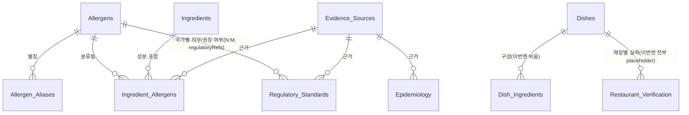

# IMP-18B — Master DB 실제 구축 결과 및 데이터 사전

> 상태: **`data/master/Food_Allergen_Master.xlsx` 생성 완료, 서비스 코드 미연동.**
> 생성 스크립트: `scripts/generate-master-xlsx.js` (exceljs, `scripts/` 폴더에만
> 격리된 1회성 개발 도구 — 런타임 앱은 여전히 의존성 0개).
> 선행 문서: [IMP-17](../research/IMP-17-allergen-standards.md),
> [IMP-18 설계](./IMP-18-master-db-design.md)

---

## 1. 데이터 사전 (Data Dictionary)

### 01_Allergens

| 필드 | 타입 | 필수 | 설명 |
|---|---|---|---|
| `id` | string | ✅ | `shared/allergens.js`와 동일 네임스페이스(영문 소문자) |
| `legacyIds` | string(콤마구분) | | IMP-11 마이그레이션용 구 id |
| `ko/en/ja/zh/vi/es` | string | ✅(활성 항목만) | 6개 언어 명칭 — **후보(candidate) 항목도 전부 6개 언어 채움**(요청사항 반영) |
| `icon` | string(emoji) | | UI 표시용 |
| `registryStatus` | enum `active` \| `candidate` | ✅ | `active`=지금 `shared/allergens.js`에 실제로 등록된 21종, `candidate`=연구로 근거는 확보했으나 아직 미등록 |
| `biologicalCategory` | string | | 생물학적 분류(어류/갑각류/연체동물/견과류 등) — "분류가 같다고 반응도 같다"고 가정하지 않기 위해 **UI 그룹핑 전용**이며 위험도 판정 로직에선 쓰지 않음 |
| `regulatoryRefs` | string(`표준id:상태` 콤마구분) | ✅ | `Regulatory_Standards.id:mandatory\|recommended\|not_listed\|unconfirmed` |
| `evidenceRefs` | string(콤마구분) | ✅ | `Evidence_Sources.id` 참조 |
| `reviewStatus` | enum `reviewed` \| `reviewed_as_candidate` | ✅ | 이 항목의 "존재와 해외 규제 근거"가 검증됐다는 뜻이지, "한국 서비스에 바로 추가해도 된다"는 뜻이 아님(그건 `registryStatus`가 결정) |
| `notes` | string | | 국가 간 차이, 미해결 모순 등 |

### 02_Allergen_Aliases

| 필드 | 설명 |
|---|---|
| `allergenId` | FK → 01_Allergens |
| `alias` | 동의어/표기 변형 |
| `lang` | `id_legacy`(IMP-11 legacyIds 승계) \| `en`(영문 표기 변형) |
| `reviewStatus` | `reviewed`(legacyIds 승계분, 이미 IMP-11에서 검증) \| `pending_expert_review`(이번에 AI가 추정한 변형) |
| `evidenceType` | `regulatory` \| `ai_estimated_general_knowledge` |

**이 시트는 의도적으로 최소 상태(16행)로 유지했다** — 본격적인 동의어/다국어
변형 테이블 구축은 IMP-12의 범위이고, 지금 무리하게 채우면 "검증 안 된
관계를 임의로 늘리는" 결과가 된다.

### 03_Ingredients / 04_Ingredient_Allergens

| 필드(04) | 설명 |
|---|---|
| `relationType` | `IS_ALLERGEN` \| `CONTAINS_AS_RAW_MATERIAL` \| `TYPICAL_RECIPE_INCLUSION` \| `PRODUCT_VARIANT_DEPENDENT` \| `OBSERVED_CROSS_CONTACT` \| `UNCONFIRMED` (IMP-18 설계의 enum 그대로) |
| `confidence` | `high` \| `medium` \| `low` |
| `evidenceType` | `definitional`(알레르겐=식재료 자체, 자명) \| `ai_estimated_general_knowledge`(이번 세션 추정) \| 향후 `manufacturer_label` / `restaurant_direct_confirmation` 등 |
| `reviewStatus` | `reviewed`(정의상 자명한 것만) \| `pending_expert_review`(그 외 전부) |

**핵심 설계 포인트**: 63건의 관계 중 **21건(IS_ALLERGEN 자명 케이스)만
`reviewed`이고, 나머지 42건(복합 식재료 18종의 실제 성분 관계)은 전부
`pending_expert_review`다.** 이것은 버그가 아니라 의도된 결과다 — 이번
세션의 AI가 "쌈장에는 보통 대두가 들어간다"처럼 일반 상식으로 추정한
관계를, "검증된 사실"인 것처럼 표시하지 않기 위한 장치다. 사용자가 지시한
"AI 추정 정보만으로 검증 완료된 지식 DB 관계를 생성하지 않는다"를 데이터
자체의 상태값으로 강제한 것이다.

### 07_Regulatory_Standards / 08_Evidence_Sources

IMP-17/17B 조사 결과를 그대로 옮긴 시트 — 데이터 사전은 [IMP-17 문서](../research/IMP-17-allergen-standards.md)와
[IMP-18 설계 문서](./IMP-18-master-db-design.md) §4-2 ⑥⑦을 참고(중복 서술 생략).

### 09_Restaurant_Verification

| 필드 | 설명 |
|---|---|
| `verificationMethod` | 지금은 **전부 `demo_placeholder`** — 실제 매장 확인이 단 한 건도 없기 때문에 사용자가 지시한 대로 "임의로 채우지 않았다" |
| `confidence` | 전부 `none` |
| `verifiedAt` | 전부 공란(실제 확인 일시 없음) |

### 10_Epidemiology

[IMP-17 문서](../research/IMP-17-allergen-standards.md) §2의 전체 필드(저자/DOI/방법론/정의/표본수/한계)를
그대로 옮김. `epi_0001`만 원문을 직접 열람해 `reviewed`, 나머지 2건은
`pending_verification`.

---

## 2. ER 다이어그램 (실제 구축 반영)

`Allergens ↔ Regulatory_Standards`는 **다대다**다 — 참깨 하나가 미국/EU/영국/
캐나다/호주뉴질랜드 5개 기준에 동시에 걸리는 것처럼, 하나의 알레르겐이
여러 국가 기준에 속하고 하나의 기준도 여러 알레르겐을 포함한다. 이번
구현에서는 `Allergens.regulatoryRefs` 필드(콤마 구분 문자열)로 단순화해
Excel에서 바로 읽기 쉽게 했지만, 실제 관계형 DB(PostgreSQL 등)로 이전할
때는 **별도의 `Allergen_Regulatory_Standards` 조인 테이블**로 정규화해야
한다(IMP-18C 변환 계획에 반영).

---

## 3. 데이터 검증 정책

| 규칙 | 적용 방식 |
|---|---|
| 모든 관계 행은 `reviewStatus`를 가져야 한다 | 04/08/10 시트 전 행에 적용, 공란 금지 |
| `reviewStatus='reviewed'`는 `evidenceId`/`evidenceRefs`가 공란이면 안 된다 | IMP-18C 변환 스크립트가 강제 검증(아래 문서) |
| AI(이번 세션)가 생성한 관계는 절대 `reviewed`로 표시하지 않는다 | `evidenceType='ai_estimated_general_knowledge'`인 행은 `reviewStatus`가 `reviewed`일 수 없음 — 변환 스크립트가 이 조합을 발견하면 빌드 실패 처리 |
| 매장 확인 정보(`Restaurant_Verification`)는 실제 확인 기록 없이 `verificationMethod`를 `confirmed`류 값으로 채울 수 없다 | 지금은 `demo_placeholder`만 존재 — 향후 실제 확인이 들어올 때만 다른 값 허용 |
| 교차오염(`OBSERVED_CROSS_CONTACT`)은 `evidenceId` 필수 | 이번 빌드에는 해당 relationType 행 자체가 없음(실제 매장 확인이 없으므로 — 정직하게 비워둠) |
| 일반 레시피(`TYPICAL_RECIPE_INCLUSION`)를 매장 확정 정보로 혼동할 수 없게 UI 분리 | [UI 설계 문서](./allergen-selection-ui-design.md) 참고 |

---

## 4. 개인정보 및 데이터 이용 조건 (요청 §10)

- **개인 알레르기 프로필(사용자의 `state.selectedAllergies`, LocalStorage의
  `fitbridge_profile_v1`)은 이 Master DB의 어떤 시트에도 포함되지 않는다.**
  Master DB는 "식품/알레르겐에 대한 공공 지식"만 다루고, "이 사용자가 어떤
  알레르기를 가졌는지"는 전적으로 브라우저 LocalStorage(개인 기기)에만
  존재한다 — 두 데이터는 설계상 완전히 분리된 별도 저장소이며, 이번 작업도
  그 경계를 넘지 않았다.
- 공공데이터(식품안전나라 Open API) 이용 조건: IMP-17 §3-1에 기록된 그대로,
  "무료", "이용허락범위 제한 없음"은 확인했으나 **공공누리 유형 번호,
  호출 한도, 2차 가공물 재배포 조건은 확인하지 못했다(검증 필요)** — 실제
  연동 전 재확인 필수.
- 동료평가 논문(`epi_0001` 등)은 저작권이 있는 학술 자료다 — Master DB에는
  **서지정보와 수치 요약만** 담았고 원문 전문을 복제하지 않았다(통상적인
  "인용" 범위로 판단되나, 상업적 재배포 전 저널 정책 확인 필요 — 검증 필요).

---

## 5. 구축 결과 — 실제 수치 (요청 §12 보고 형식에 맞춘 핵심 통계)

실행: `node scripts/generate-master-xlsx.js` → `data/master/Food_Allergen_Master.xlsx`
(재오픈 검증 완료, 11개 시트 전부 정상)

| 항목 | 목표(참고용) | 실제 확보 | 상태 |
|---|---|---|---|
| 공식 규제·연구 출처(Evidence_Sources) | 20개 이상 검토 | **19개** | 목표에 근접(1개 부족), 전부 실제 열람/검색한 출처 |
| 알레르기 표준 성분(01_Allergens) | 30~50개 후보 | **39개**(active 21 + candidate 18) | 목표 범위 내 — **전부 실제 해외 규제 근거 보유**, 임의 추가 없음 |
| 식재료(03_Ingredients) | 100개 이상 후보 | **39개**(복합 18 + 단일 21) | **목표 미달(약 39%)** — 정직하게 보고. 복합 식재료 18종은 섹션6 지정 전량 등록, 나머지 60여 개는 미착수 |
| 복합 식재료 및 소스 | 20~30개 | **18개**(섹션 6 지정 항목 전량) | 거의 목표 하한 도달 |
| 대표 음식·메뉴(05_Dishes) | 30~50개 | **14개**(기존 데모 전량 재사용) | **목표 미달** — 신규 음식 조사는 미착수 |
| 다국어 명칭 | 6개 언어 | **6개 언어 전량**(active+candidate 39종 모두) | 목표 달성 |
| 검토 완료(reviewed) 관계 수 | — | Allergens 21 reviewed + 18 reviewed_as_candidate / Ingredient_Allergens 21 reviewed / Regulatory_Standards 8 reviewed / Evidence_Sources 19 reviewed / Epidemiology 1 reviewed | — |
| 검토 대기(pending) 데이터 수 | — | Ingredient_Allergens 42건 pending_expert_review / Allergen_Aliases 14건 pending / Epidemiology 2건 pending_verification / Dishes 14건 demo_content(별도 카테고리) | — |

**정직한 평가**: 성분(Allergens)과 출처(Evidence_Sources) 조사는 목표
범위에 들었지만, **식재료·음식 데이터는 아직 초기 시드 수준**이다. 이는
"검증되지 않은 데이터로 개수를 채우지 않는다"는 지시를 지키기 위한
당연한 결과이며, 다음 단계에서 실제로 조사를 확장해야 할 부분으로
명확히 남겨둔다.

---

## 6. IMP-12 / IMP-02 연동 계획 (갱신)

- **IMP-12**: `02_Allergen_Aliases`의 `ai_estimated` 행들은 IMP-12 작업 시
  "검토 전 후보 목록"으로 그대로 재사용 가능 — IMP-12가 이 후보들을
  검토·확정하면 `reviewStatus`만 `reviewed`로 승격시키면 된다(구조 변경 불필요).
- **IMP-02**: `04_Ingredient_Allergens`가 1단계 검증(표준 id 존재 여부)을
  넘어 2단계 검증(이 dish/ingredient에 이 allergen이 실제로 보고된 적
  있는가)의 데이터 기반이 된다 — 단, 지금 대부분이 `pending_expert_review`
  이므로 IMP-02 2단계는 **이 pending 데이터들이 실제로 검토·승격된 이후**에
  의미 있게 작동한다(지금 당장 2단계 검증 로직을 짜는 것은 시기상조).

---

## 7. 남은 한계 (정직하게 기록)

1. **식재료 100개, 음식 30~50개 목표에 크게 못 미친다.** 이번 세션은
   "검증 가능한 범위"를 우선했고, 양적 목표를 임의 데이터로 채우지 않았다.
2. **Ingredient_Allergens 관계의 2/3(42/63)가 `pending_expert_review`다.**
   실제 식품영양 전문가 검토 또는 제조사 원재료 표시 대조 없이는 "검증됨"으로
   승격시키지 않는다.
3. **Codex의 역사적 연원(1999 vs 참깨 포함 여부)은 끝내 확정하지 못했다.**
4. **공공데이터 2차 가공물의 재배포 조건(공공누리 유형)을 확인하지 못했다.**
5. **Dish_Ingredients 시트는 의도적으로 비웠다** — 기존 데모 데이터의
  `ingredients` 필드가 자유 텍스트라, 이를 기계적으로 쪼개 구조화된 관계로
  만들면 "검증 안 된 관계의 임의 생성"이 되기 때문이다.
